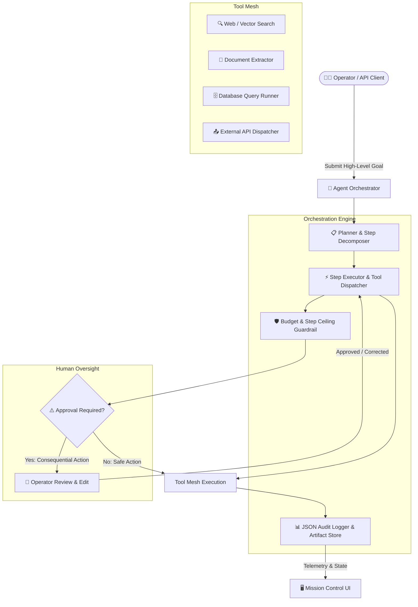

# ⚡ Autonomous Agent Orchestrator & Execution Engine - Showcase

**Multi-step AI systems your team can actually audit, correct, and trust.**

A resilient task-completion state engine that decomposes complex goals into observable steps, executes typed tools, enforces strict cost ceilings, and integrates human-in-the-loop approval gates before consequential actions.

🌐 **Interactive Web App & GPU Sizing Academy:** [https://mibrahimai.github.io/agent-orchestration-showcase/](https://mibrahimai.github.io/agent-orchestration-showcase/)

---

## 🎯 Positioning & Core Philosophy

> Serious enterprise buyers don't want a "magic" autonomous black box that burns API credits in runaway loops. They want multi-step automation that can be **audited, corrected, and halted**.

- **Not a Chatbot:** Built for mission completion, tool orchestration, and artifact generation—not conversational back-and-forth.
- **Failures Made Boring:** Individual step retries with exponential backoff, partial successes (e.g., 8/10 items completed, 2 escalated), and deterministic state preservation.
- **Human-in-the-Loop by Design:** Consequential mutations (sending external communications, modifying databases, releasing funds) pause execution, notify a human reviewer, and resume cleanly without losing context.

---

## 🚀 Key Architectural Pillars

### 1. Deterministic Planning & Tool Execution
- Strict input/output validation on all registered tools with robust error boundaries.
- Iterative observe-reason-act loops with adaptive failure recovery.
- Strict step limits and hard dollar cost ceilings to eliminate infinite loop risk.

### 2. Full Audit Trail & Observability
- Every step recorded as structured JSON: decision rationale, tool inputs, responses, token usage, exact execution cost, and latency.
- Full run replayability and the ability to re-run from an arbitrary step without paying for earlier steps twice.
- File and data artifacts linked directly to their generating execution step.

### 3. Human-in-the-Loop Approval Gates
- Policy-driven approval triggers on high-impact actions.
- Clean pause-and-resume protocol that preserves memory states and execution graphs.
- Direct human intervention: operators can edit intermediate step outputs before resuming downstream agents.

### 4. Mission Control Dashboard
- Real-time Next.js web console showing active runs, step execution timelines, cost accumulators, live logs, and approval prompts.

---

## 🏗️ System Architecture



---

## 📚 AI Architecture & Hardware Sizing Academy

This repository also includes the complete **AI Engineering Mastery Curriculum** to calculate memory budgets and hardware costs for enterprise LLMs:

| Module | Topic | Key Takeaway |
| :--- | :--- | :--- |
| **01** | [Parameters & Scale](tutorial/01_model_parameters_and_scale.md) | Why 14B models out-reason 1.5B models; compute FLOPs per token. |
| **02** | [Bits & Quantization](tutorial/02_precision_and_quantization_bits.md) | 16-bit half precision vs 4-bit NormalFloat; why 14-bit does not exist. |
| **03** | [VRAM Math & Sizing](tutorial/03_vram_calculation_and_gpu_sizing.md) | The 30-second mental formula: 2GB/B (16-bit), 1GB/B (8-bit), 0.5GB/B (4-bit). |
| **04** | [Inference vs Training](tutorial/04_inference_vs_training_lora_qlora.md) | AdamW memory trap (16–18 B/param) vs LoRA/QLoRA adapter efficiency. |
| **05** | [Client Consulting Playbook](tutorial/05_client_consulting_playbook.md) | Word-for-word scripts for client calls, architect interviews, and objection handling. |

---

## 💻 Runnable Verification Scripts

Located in [`tutorial/practice/`](tutorial/practice/):

```bash
# 1. Verify byte allocations for FP32, FP16, and INT8 in RAM
python tutorial/practice/01_verify_bits_and_bytes.py

# 2. Interactive CLI tool for hardware sizing & cloud cost calculations
python tutorial/practice/02_vram_calculator.py --params 14 --bits 4 --context 4096

# 3. Simulate continuous float quantization to 4-bit integers & byte packing
python tutorial/practice/03_quantization_simulator.py
```
