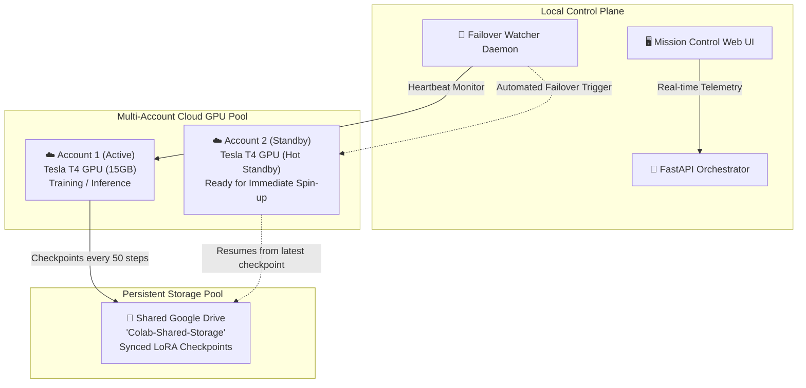

# ⚡ Distributed Agent Orchestrator & Colab GPU Mesh - Showcase

> 🔒 **Architecture Note (Portfolio Strategy):** 
> To protect core intellectual property, this repository acts as a **100% Hollow Showcase & Educational Hub**. The live application—including private FastAPI orchestration daemons, multi-account PKCE Google Colab credential rotators, headless WSL automation hooks, and custom PyTorch training kernels—is securely maintained in a private repository and deployed on private infrastructure.

---

**Continuous, Zero-Cost Cloud GPU Pooling for Distributed AI Fine-Tuning & Multi-Agent Inference.**

A self-healing, multi-account compute fabric that bypasses Google Colab's ~12-hour VM timeouts and GPU quota limits. The system rotates active sessions across a pool of Google accounts, mounts shared cloud storage for persistent checkpointing, and dynamically resumes training or inference jobs without dropping a single step or losing progress.

🌐 **Interactive Web App & GPU Sizing Academy:** [https://mibrahimai.github.io/agent-orchestration-showcase/](https://mibrahimai.github.io/agent-orchestration-showcase/)

---

## 🚀 System Highlights

- **48-Hour Continuous GPU Pooling:** Automatically cycles active sessions across authenticated Google accounts (`account_1`, `account_2`, ...) using PKCE OAuth tokens and headless CLI drivers.
- **Shared Storage Persistence:** Mirrored Google Drive checkpointing pool (`Colab-Shared-Storage`) ensures weights, optimizer states, and dataset pointers persist seamlessly across VM terminations.
- **Dynamic Failover Recovery:** Autonomous watcher daemons detect cloud runtime disconnects, initiate standby worker spin-ups within 90 seconds, and resume training from the latest checkpoint.
- **Stress-Tested Benchmark:** Successfully completed a continuous **10,000-step QLoRA fine-tuning benchmark** on cloud NVIDIA Tesla T4 hardware with zero data loss and stable training loss convergence.
- **Mission Control Telemetry:** Real-time web dashboard displaying worker mesh health, account quota pools, active VRAM usage, loss curves, and instantaneous failover event feeds.

---

## 🏗️ System Architecture



---

## 📚 AI Architecture & GPU Sizing Academy

This repository also contains the complete **AI Engineering Mastery Curriculum** to calculate memory budgets and hardware costs for enterprise LLMs:

| Module | Topic | Key Takeaway |
| :--- | :--- | :--- |
| **01** | [Parameters & Scale](tutorial/01_model_parameters_and_scale.md) | Why 14B models out-reason 1.5B models; compute FLOPs per token. |
| **02** | [Bits & Quantization](tutorial/02_precision_and_quantization_bits.md) | 16-bit half precision vs 4-bit NormalFloat; why 14-bit does not exist. |
| **03** | [VRAM Math & Sizing](tutorial/03_vram_calculation_and_gpu_sizing.md) | The 30-second mental formula: 2GB/B (16-bit), 1GB/B (8-bit), 0.5GB/B (4-bit). |
| **04** | [Inference vs Training](tutorial/04_inference_vs_training_lora_qlora.md) | AdamW memory trap (16–18 B/param) vs LoRA/QLoRA adapter efficiency. |
| **05** | [Client Consulting Playbook](tutorial/05_client_consulting_playbook.md) | Word-for-word scripts for client calls, architect interviews, and objection handling. |

---

## 💻 Runnable Verification Scripts

Located in [`tutorial/practice/`](tutorial/practice/):

```bash
# 1. Verify byte allocations for FP32, FP16, and INT8 in RAM
python tutorial/practice/01_verify_bits_and_bytes.py

# 2. Interactive CLI tool for hardware sizing & cloud cost calculations
python tutorial/practice/02_vram_calculator.py --params 14 --bits 4 --context 4096

# 3. Simulate continuous float quantization to 4-bit integers & byte packing
python tutorial/practice/03_quantization_simulator.py
```
